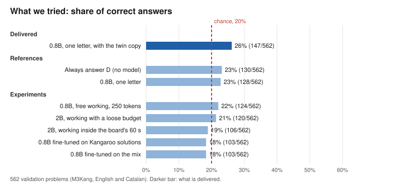
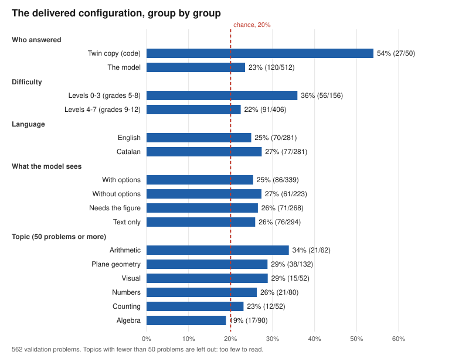
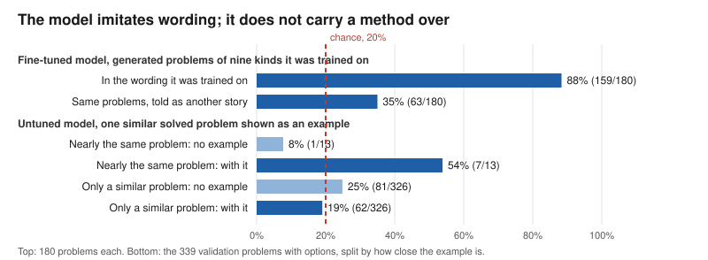

# Tutor Cangur: an offline maths tutor on the Arduino UNO Q

Tutor Cangur helps primary school students (10 to 12 years old) practise Kangaroo competition problems **without being given the answer**. The student works on a web page served by the board. The tutor gives graded hints, checks intermediate results and explains typical mistakes. The board's LED matrix and RGB LED show what is happening: a tick, a cross, the hint step, or a colour.

Everything runs on an Arduino UNO Q 4 GB with no internet connection, so no student data leaves the device. Built at the Datathon FME 2026 for the Qualcomm challenge [Math on the Edge](DATATHON.md).

**Arduino Project Hub:** the step-by-step write-up, "CangurMath: an offline maths tutor on the Arduino UNO Q", is submitted and waiting for Arduino's review. It will be listed on [projecthub.arduino.cc/perearenas](https://projecthub.arduino.cc/perearenas) once approved.

## The short version

- **Teach:** works well because the hints are written ahead of time and the tutor is plain Python. Help appears instantly, and a leak check stops any hint that reveals the answer.
- **Reason:** the 0.8B model on the board answers at chance level (22.8% on 562 validation problems, chance is 20%). Overnight we tried three fine-tunes, free step-by-step working, a worked example of a similar problem, a calculator pass and a 2B model: none made it solve Kangaroo problems, and a transfer test showed why (88% on a problem family in the wording it was trained on, 35% when the same problems are told as another story). What does help is code: copying the answer of a twin problem from the training set lifts `predict.py` to **26.2%** (147/562), which is what we deliver.
- **Our bet:** on a board that writes about 5 tokens per second, a live model is the wrong tool for hints. We spend the model's time only where it is optional, and guard what it writes.

## What it does

| The student | The tutor | The board shows |
|---|---|---|
| Opens a problem | Shows the original image and the options A to E | Blue |
| Asks for a hint | Hint 1: where to look. Hint 2: how to start. Hint 3: the key step | Purple, and the step number on the matrix |
| Keeps asking | Asks for an intermediate result and checks the number | Tick or cross |
| Asks again | Shows the method for this type of problem, then an easier solved problem | Step number |
| Answers wrong | Explains the likely mistake behind that option | Red, and a cross |
| Answers right | Picks the next problem: harder, or another topic after three in a row | Green, and a tick |
| Types a question | Routes it: a hint, an answer, off topic, or a question for the model | Yellow while the model works |
| Opens "El meu mapa" | Shows each topic by level (new, tried, shaky, solid) from the tutor, the practice problems and the exams, and what to try next; a class view by animal pseudonym for the teacher | A column per topic, taller the more solid, and a dot over what to try next |
| Opens "Mode examen" | A timed Kangaroo paper by level, marked with Kangaroo-style scoring (the exact rules are a setting still to be checked); the misses become one review queue for the tutor | A countdown on the matrix |
| Asks for "Un de semblant" (or answers wrong) | Makes a fresh problem of the same topic with a computed answer, drawn by the page when the topic needs a figure; each wrong option names the slip behind it | Tick or cross |
| Opens "Sessió d'avui" | Plans three problems from the map (one shaky topic, one just begun, one new), after a warm-up of three short ones | Step of the session |
| Chooses how to read | One idea per line, more room, key data marked, or the numbers only; remembered, never shown to anyone else | – |
| Opens a new problem | A quiet ring gives a moment to think before the hint button appears (think-first timer) | The same ring on the matrix |

The solution is shown only when the student asks for it.

## Architecture

```text
Laptop browser  ── USB (adb forward) or Wi-Fi ──►  port 7000
                                                      │
Arduino UNO Q, Linux side (Qualcomm QRB2210)          ▼
  App Lab app "Tutor Cangur" (Docker container)
    assets/index.html      the student's page (teach/index.html)
    python/main.py         the API for the page
    copilot/tutor.py       answers, help ladder, next problem      no model
    copilot/diagnose.py    the mistake behind a wrong option       no model
    copilot/assistant.py   routes free text, checks model output
    copilot/guardrails.py  blocks answers, invented numbers, copies
          │                               │
          │ Bridge.call("draw", frame)    │ HTTP, through board/llm_bridge.py
          ▼                               ▼
  STM32 microcontroller             llama-server, 127.0.0.1:8081
    sketch.ino draws the frame        Qwen3.5 0.8B Q8_0 (optional hints)
    on the 8x13 LED matrix          llama-server, 127.0.0.1:8082
  RGB LED 1 (set from Linux)          bge-small-en-v1.5 (similar problems)
```

- **Linux side:** the tutor is plain Python with no model. It reads a catalogue prepared ahead of time, so help is instant.
- **Microcontroller:** the sketch only draws the frame it receives. Python decides every pixel.
- **Language model:** used only for a model hint or a free question. Its output is shown only if it passes the guardrails. Otherwise the student gets a written hint.
- **`predict.py`:** the entry point the jury runs. It is independent of the tutor, the page and the LEDs.

### How we use M3Kang

- **A catalogue for teaching.** Each of the 1,747 problems gets a topic (11-topic taxonomy), a school grade and a difficulty from its position in the exam.
- **Written help for the 154 primary-school problems in Catalan.** Three graded hints, a solution, up to three checkpoints with a numeric answer, and notes on wrong options. Written by Claude while looking at each problem's image. Each item carries a status: `generado` (by a model), `preparado` (by a person) or `revisado` (checked by a person).
- **The anatomy of 804 solved problems.** The data that matters, the easy-to-miss condition, the strategy (from a closed list of 15) and the first step.
- **Similar problems.** The embedding model finds an easier problem of the same type to show as a worked example.
- **Training data** to fine-tune the small model (in progress).

## How to replicate it

Start from a board set up with steps 0 to 12 of [DATATHON.md](DATATHON.md): both model services running, and M3Kang prepared on the laptop with `laptop/prepare_m3kang.py --save-images`.

**1. Build the teaching catalogue (laptop).** It needs topic labels and help content in `data/catalog/content/`. These hold M3Kang text, so they are not in this repository. Generate them yourself with the `FORMAT_*.md` briefs, then:

```bash
python3 laptop/merge_hints.py        # checks hints: right letter, no leaked answer
python3 laptop/build_catalog.py --labels "data/catalog/content/labels/*.jsonl"
```

You should see `Wrote data/catalog/problems.jsonl: 3494 rows, 1747 problem ids`.

**2. Try it on the laptop, without the board.**

```bash
python3 teach/server.py              # then open http://127.0.0.1:8010
```

**3. Package the App Lab app and copy it to the board (laptop).**

```bash
python3 applab/package.py            # -> applab/build/math-tutor
adb push applab/build/math-tutor /home/arduino/ArduinoApps/
```

**4. Let the app reach the language model (board).** App Lab runs the app in a container, where `127.0.0.1` is not the board. `board/llm_bridge.py` forwards the model's port on the Docker interface only. To start it at boot, install `board/systemd/math-llm-bridge.service` as described in [applab/README.md](applab/README.md).

**5. Start the app (board).**

```bash
export TMPDIR=/tmp                   # only needed inside `adb shell`
arduino-app-cli app start user:math-tutor
```

The sketch compiles on first start, about a minute. You should see `App "Tutor Cangur" started successfully`.

**6. Open the page (laptop).**

```bash
adb forward tcp:7000 tcp:7000        # then open http://127.0.0.1:7000
```

Ask for a hint: RGB LED 1 turns purple and the matrix shows the step. Answer wrong: red and a cross. Answer right: green and a tick.

**7. Run the official answering run (board).** From the repository folder on the board, with `data/train.jsonl` in place (the twin copy reads it; without it the model answers every problem):

```bash
python3 predict.py --input data/val.jsonl --output results/predictions.csv   # one letter per problem
python3 eval.py --input data/val.jsonl --languages eng,cat --limit 0 --name delivery   # the same run, scored
```

`eval.py` prints accuracy with its interval, latency, the breakdown by language, level and options, and how many problems the twin copy answered. `PRESOLVE=` (empty) in the environment turns the twin copy off.

**8. Repeat the fine-tuning experiments (laptop, optional).** `laptop/build_training_data.py` builds the training file (it refuses to include validation or sample-test problems), `laptop/make_ft_sets.py` cuts a set, `mlx_lm.lora` trains, and `laptop/adapter_to_gguf.py` converts the result with the board's own llama.cpp converter. `laptop/bench_exam.py`, `laptop/measure_examples.py` and `laptop/reworded_problems.py` are the measurements quoted in [Results](#results). The log of every experiment is in [docs/lab/NOTEBOOK.md](docs/lab/NOTEBOOK.md).

**Tests** (standard library only): `python3 -m unittest discover -s tests`.

## Results

All numbers are on stated problems and come from `results/ablations.csv`. Runs on 50 problems or fewer say so.

What `predict.py` runs: the Qwen3.5 0.8B answers with one letter, and before it, code copies the answer of a twin problem when the training set holds one (`copilot/presolve.py`, on by default). Kangaroo papers reuse a problem at neighbouring levels of the same year; when the problem asked is almost word for word a training problem, the value of that problem's answer is looked for among the options. It never matches the problem's own id or its translation, and it only knows the training split.

| Run | Where | Problems | Accuracy (95% interval) |
|---|---|---|---|
| **0.8B, one letter, with the twin copy (what we deliver)** | laptop, `eval.py` | 562 English and Catalan validation | **26.2% (22.7–29.9), 147/562** |
| 0.8B, one letter (baseline) | laptop | 562 | 22.8% (19.5–26.4), 128/562 |
| 0.8B, one letter (baseline) | board | 281 English validation | 22.4% (17.9–27.6), 8.8 s mean, 19.2 s worst |
| Always answer D (no model) | – | 562 | 23.1% |

The twin copy answers 50 of the 562 problems without the model and is right on 27; two runs gave the same 562 letters. Chance is 20% with five options, and 223 of the 562 problems arrive without readable options.

**The model itself does not solve Kangaroo problems, and we measured why.** Everything below is the 0.8B unless it says otherwise, on the same 562 problems.

| What we tried | Result |
|---|---|
| Free step-by-step working, 250 tokens | 22.1% (2B: 21.2%) |
| Fine-tuned to answer the letter | 17.3% measured on a broken file; the idea was dropped, the model only learned to guess evenly |
| Fine-tuned on 3,883 checked Kangaroo solutions, writing its working | 18.3% |
| Fine-tuned on a mix: Kangaroo solutions, 6,000 generated problems, 1,000 AQuA | 18.3% (20/100 on 100 unseen 2026-style problems) |
| The same model on 300 fresh generated problems | 54.7%, up from about 19% before tuning |
| The same generated problems told as another story (same numbers) | 35% reworded against 88% in the trained wording |
| One similar solved problem shown as a worked example | 20% → 17%; but 2/13 → 8/13 when the example is nearly the same problem |
| Python recomputing every sum in the working | −1 problem of 339 |
| Qwen3.5 2B, free working, inside 60 s at the board's real speed (2.5 tokens/s) | 18.9%: it finishes no working at all |

So the small model imitates what it has seen and cannot deduce: it learns the wording of a problem family, not the maths, and a worked example helps only when it is almost the same problem. That is why the one thing that raises the score is the twin copy. On the board the fine-tuned model writes its working in 34 s on average (worst 58 s), reads 11.7 and writes 5.7 tokens per second.

A statistical prior over answer positions and option shapes, learned from the training split, scored 151/562 (26.9%). We left it off: it does not solve anything.

### Teach: help for the catalogue's problems

Measured with `measure_teach.py coverage` on the 154 primary-school problems in Catalan.

| Measure | Before | After writing help per problem |
|---|---|---|
| Problems with hints about that problem | 0 | 154 |
| Hints in total | 0 | 462 |
| Checkpoints the student can be asked | 93 | 322 |
| Problems with a solution to show on request | 48 | 154 |
| Help items stopped by the leak check | 0 | 0 |

- **Who checked it.** In the 106 problems solved without knowing the answer, the letter matched the verified one every time.
- **Hints seen vs. hints from the solution text,** compared blind by a model judge: with the image 66, from the solution 53, 35 ties. With a figure, image-based hints won 39 to 26.
- **Wrong-answer feedback.** With reviewed content only, rules explain 89 of 616 possible wrong choices (14.6%).

### Teach: the live model as a hint writer

48 primary-school problems treated as new, on the board.

| Measure | Result |
|---|---|
| Model hints that pass the guardrails | 17 of 48 (35%, 23–50%) |
| Main reasons to reject | restates the question 21, copies the problem 8 |
| Seconds per hint | 10.8 mean, 20.8 worst |

Passing the guardrails is not the same as being useful: in a hand check of 8 problems, none of the hints was usable, including the three that passed.

### Strategy for problems outside the catalogue

Held-out problems: the 154 of levels 0 and 1, each with its own year removed from the index.

| How the strategy is chosen | Right strategy |
|---|---|
| Two annotators reading the solution agree (ceiling) | 137 of 154 (89%) |
| Always the most common strategy (floor) | 23 of 154 (15%) |
| Nearest problems by embedding, best setting | 37 of 154 (24%) |
| The model picks one of the 15 strategies | 4 of 48 (8%), always the first option |

## Error analysis

Of what we deliver: the 0.8B answering one letter, with the twin copy before it, on the 562 validation problems (M3Kang, English and Catalan). Every table with its 95% intervals is in [docs/error-analysis-delivery.md](docs/error-analysis-delivery.md).

**Overall: 147/562 = 26.2%.** The model alone gets 128/562 and always answering D gets 130/562.





| Who answered | Problems | Right |
|---|---|---|
| Twin copy (code, no model) | 50 | 27 (54%) |
| The model | 512 | 120 (23%) |

| By language | Right | | By difficulty | Right |
|---|---|---|---|---|
| English | 70/281 (25%) | | Levels 0–3 (grades 5–8) | 56/156 (36%) |
| Catalan | 77/281 (27%) | | Levels 4–7 (grades 9–12) | 91/406 (22%) |

| By what the model can see | Right |
|---|---|
| With options read from the image | 86/339 (25%) |
| Without options (they are only in the picture) | 61/223 (27%) |
| Needs the figure | 71/268 (26%) |
| Text only | 76/294 (26%) |
| Has options and needs no figure | 51/204 (25%) |

| By topic | Right | | By topic | Right |
|---|---|---|---|---|
| Plane geometry | 38/132 (29%) | | Counting | 12/52 (23%) |
| Algebra | 17/90 (19%) | | Space geometry | 6/40 (15%) |
| Numbers | 21/80 (26%) | | Logic | 3/22 (14%) |
| Arithmetic | 21/62 (34%) | | Patterns | 8/18 (44%) |
| Visual | 15/52 (29%) | | Measurement | 6/14 (43%) |

What the numbers say:

- **The gain comes from code, not from the model.** The twin copy answers 50 problems and is right on 27; on the other 512 the model is at 23%, which is what always answering D gives.
- **The model has a letter habit, not a method.** It answers D 243 times and A 138 times out of 562, and C and E 40 times together, while the true answers are spread almost evenly (94 to 130 each).
- **Seeing more does not help it.** It scores the same with options (25%) and without (27%), and the same on problems that need the figure (26%) and on text-only ones (26%). A solver that read the problem would do better where it has the options and no figure; this one gets 51/204 there.
- **Difficulty is the only real slope**: 36% on grades 5–8 against 22% on grades 9–12. Part of it is the twin copy, which finds more twins among the lower levels.
- **Language makes no difference** (25% English, 27% Catalan).
- **Topics**: with 562 problems, cells under about 50 problems cannot support a claim (logic 22, patterns 18, measurement 14). Among the larger ones, algebra (19%) and space geometry (15%) are the weakest and arithmetic (34%) the strongest, all inside or near the noise.
- **Speed is not the limit.** On the board: 8.5 s per problem on average, 15.2 s the worst, none over 60 s (30 validation problems), and 7.3 s on the 100 sample problems.



Why the model fails, from the experiments in [Results](#results): it imitates wording instead of solving (88% on a problem family in its trained wording, 35% when the same problems are told as another story); a worked example helps only when it is almost the same problem; when it sets up an expression for Python to compute, the value is a listed option in 15 of 172 Kangaroo problems and right in none; and giving it all the time it wants gets 26 of 100 text-only problems. Three limits stand behind that: 40% of the problems arrive without their options, about half need a figure the model does not see, and a 0.8B model reasons too little for competition problems.

## What didn't work, and what's next

- **The live model as a hint writer.** It restates the question or writes nonsense. We moved to hints written ahead of time, and kept the model behind guardrails as an extra.
- **A bigger model.** With one letter the 2B and 4B scored the same as the 0.8B, and inside the board's 60 seconds the 2B cannot finish any working.
- **Fine-tuning.** Three fine-tunes, none above chance on Kangaroo problems. The model learns the wording of the families it is trained on (88% in the trained wording, 35% when the same problem is told as another story).
- **Giving the model more to work with.** A worked example of a similar problem, a calculator pass over its sums, and matching its result to the options: none helped, except an example that is nearly the same problem.
- **A converter trap.** A fine-tuned model converted to GGUF with a newer llama.cpp than the board's loads on the laptop and is refused by the board. `laptop/adapter_to_gguf.py` uses the board's own converter.
- **Retrieving a strategy by embeddings, and letting the model choose one.** Both are close to the floor (see the table above). The embedding model is English and the statements are Catalan.

- **Tutor features added on the last night** (practice problems, exam mode, skill map and session plan, reading modes, warm-up, think-first timer): they pass their tests and the board serves them, but nobody has clicked through them in a browser yet, the exam's scoring rules are a setting to be checked, and their Catalan has not had a native read.

Next:

- Have a person review the hints and the checkpoint answers, starting with the problems the writers flagged as doubtful.
- Finish the comparison of hint sources for new problems: the model with near problems as examples, and rules on the statement, each judged on the same 48 problems.
- Let the model with its vision projector read the options from the image: 40% of the problems arrive without them, and reading is closer to what this model can do than solving.
- Try a fine-tune on hints (the set is built by `laptop/make_hint_ft_set.py`, with 2023 and 2024 held out).
- Measure the letter-bias correction for `predict.py` (`calibrate.py`) on the board: the model answers A or D four times out of five.
- A demo with Wi-Fi off, and a check of the matrix and the LED colours by eye.

## Repository map

| Path | What it holds |
|---|---|
| `predict.py`, `copilot/pipeline.py`, `llm.py`, `rag.py`, `presolve.py`, `find_letter.py`, `prior.py` | The official answering run: the model, the twin copy before it, and the settings that are off (working before the letter, a statistical prior) |
| `copilot/tutor.py`, `diagnose.py`, `assistant.py`, `match.py`, `guardrails.py`, `topics.py`, `slm.py`, `matrix.py` | The tutor |
| `copilot/practice.py`, `pictures.py`, `exam.py`, `skillmap.py`, `reading.py` | Generated practice problems (with drawn figures), the exam mode, the skill map and session plan, the reading modes |
| `teach/`, `applab/`, `led_demo/` | The student's page, the App Lab app, an LED test app |
| `explorer/` | A page to browse problems and the model's answers |
| `board/` | Setup scripts, service files, tools that run on the board |
| `laptop/` | Data preparation, catalogue, hints, training data and problem generators, fine-tuning tools, model comparison and benchmarks |
| `content/` | Method cards per topic and the list of strategies (no M3Kang text) |
| `eval.py`, `analyze_errors.py`, `error_report.py`, `calibrate.py` | Measuring the answering run |
| `measure_teach.py`, `measure_newproblem.py` | Measuring the teaching side |
| `tests/` | Unit tests |
| `docs/` | The error analysis in full, and the lab notebook, ideas and product log of the overnight work |
| `DATATHON.md` | The organizers' guide |

## The team

Pere Arenas, Marina Dasca, Mohamed Yousuf and Carlos Palazón, Datathon FME 2026 (UPC).

Built with [llama.cpp](https://github.com/ggml-org/llama.cpp), [Qwen3.5 0.8B](https://huggingface.co/Qwen), [bge-small-en-v1.5](https://huggingface.co/BAAI/bge-small-en-v1.5), Arduino App Lab and the organizers' starter repository. Teaching content and parts of the code were written with Claude.

## License

Our code: MIT (see `LICENSE`). M3Kang is not ours and keeps its own research-only license.
